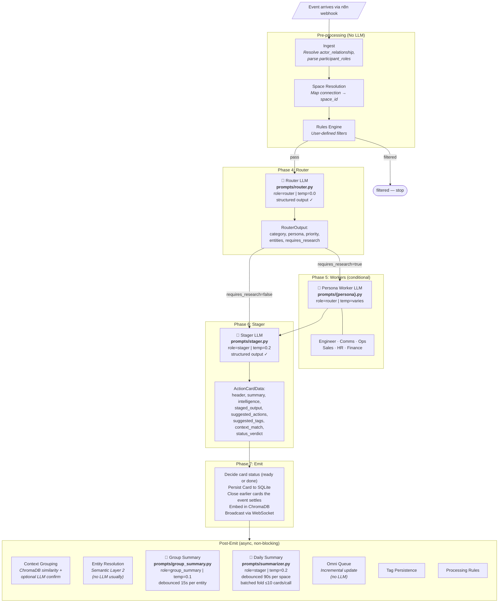
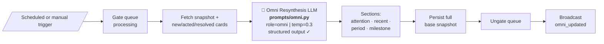
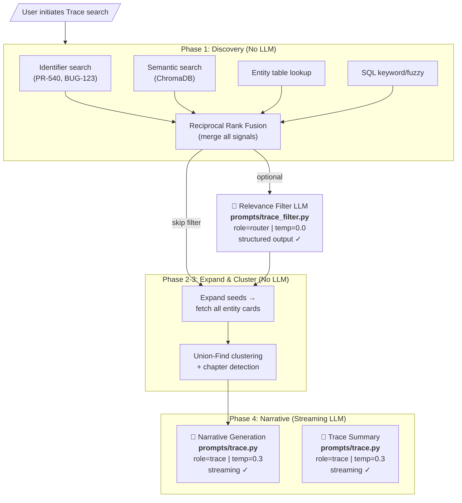
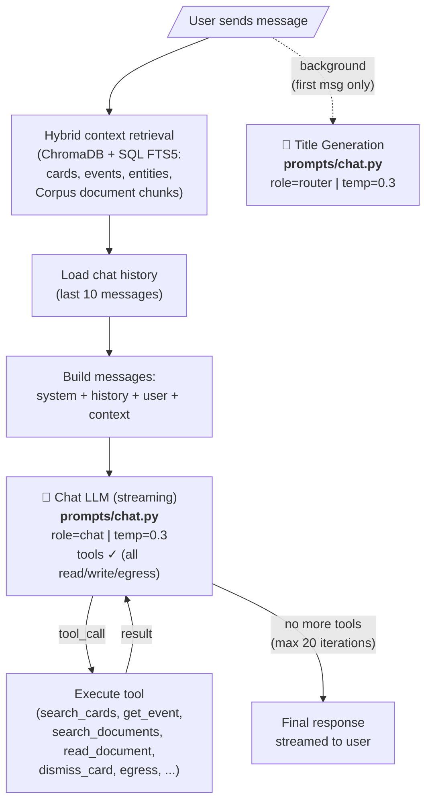
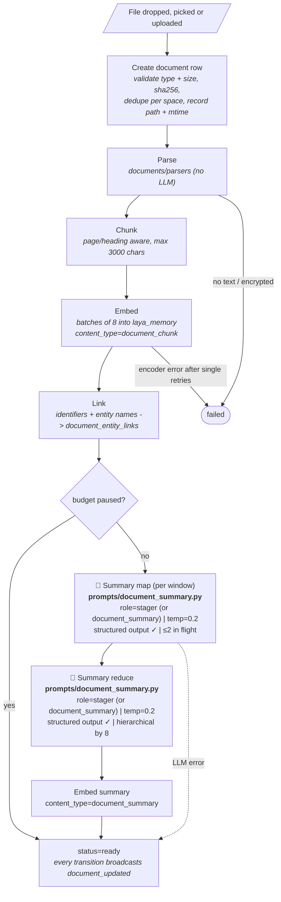
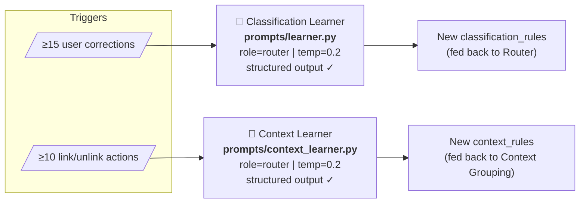
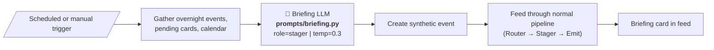
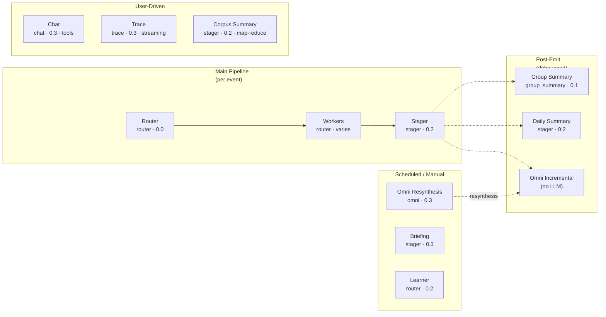

# Laya Pipeline Lifecycle — Prompt Stages

## Event Processing Pipeline (Main Flow)



## Card Status (decided by the Stager)

A card is created `ready` or `done`. The stager LLM decides which, in the same
call that writes the card. The code has no list of platforms or event types for
this.

**What the stager is asked.** The rules are `CARD_STATUS_RULES` in
`llm/prompts/stager.py`, appended to the stager system prompt for every
platform. The stager returns a `card_status` object:

| Field | Values | Meaning |
|---|---|---|
| `reason` | one sentence | The evidence for `event_effect`. Written first. |
| `event_effect` | `concludes`, `reopens`, `standalone_notice`, `none` | What this one event does to its work item (the pull request, ticket, thread, meeting or page). |
| `status` | `ready`, `done` | Status of the card being written. |
| `settled_refs` | list of `#` numbers | Earlier ready cards this event settles while the work item stays open. |

**What the stager sees.** `[WORK ITEM TIMELINE]` in the user message lists the
earlier cards of the same `entity_id` (event time at or before this event,
oldest first, at most 40) and ends with "Before this event the work item was:
open | concluded". `pipeline/stager.py` builds it and maps the `#` numbers the
stager returns back to `card_id`s.

**What the code does with the answer** (`pipeline/card_status.py`, called from
`emit.run_emit` under a per-entity lock):

1. Validate. An `event_effect` or `status` outside the allowed values drops the
   whole answer and the card is `ready`.
2. Work item state before the event: the most recent earlier card whose stored
   `status_effect` is `concludes` or `reopens` decides it. No such card means
   open.
3. Work item state after the event: `concludes` gives concluded, `reopens`
   gives open, `none` and `standalone_notice` leave it unchanged.
4. The new card is `done` only when the state after the event is concluded and
   the stager said `done`. A `done` on an open work item is ignored.
5. `concludes` closes every earlier `ready` card of the entity. Otherwise the
   cards named in `settled_refs` are closed.
6. A card for an older event that is emitted after a later event already
   concluded the work item is created `done`.

Limits: only `ready` cards are closed, only cards with event time at or before
the closing event, and never a card the user reopened after Laya closed it. A
status set by a persona worker is kept.

**Stored on `action_cards`** (migration 075): `status_effect` (the stager's
answer), `status_reason` (why Laya set the card to `done`), `status_set_by`
(`laya`, or `user` after the user reopened a card Laya closed). A card Laya
closes keeps `read_at` NULL, so it still counts as unread.

**Switch.** `pipeline.llm_card_status` in settings.json (Settings → Models →
Advanced), default on. When off, the rules and the `card_status` schema object
are not sent, every card is created `ready`, and Laya closes nothing.

**Override.** `~/.laya/prompts/stager_card_status.md` replaces the rules. A
`stager.md` override does not remove them.

## Omni Resynthesis (Scheduled)



## Trace (User-Initiated Search)



## Chat (Multi-Turn with Tools)



## Corpus Document Ingest (User-Initiated)



Parsing and chunking failures are fatal; a summary failure records `error_code=summary_error` on a document that is still `ready` and searchable. `POST /documents/{id}/reprocess?stage=embed|summarize|link` re-runs one stage from the stored chunks.

## Learning Pipelines (Feedback-Driven)



## Briefing (Scheduled/Manual)



## Complete LLM Touchpoint Summary



## Date/Time Injection

All LLM calls receive temporal awareness via centralized injection in `llm_call()`:

```
[Current date/time: 2026-06-07 14:30:00 UTC (Saturday)]

{actual user message content}
```

This is injected into the **last user message** (not the system prompt) to preserve prompt caching.
